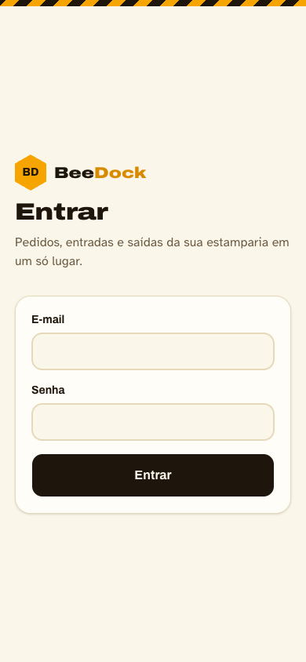
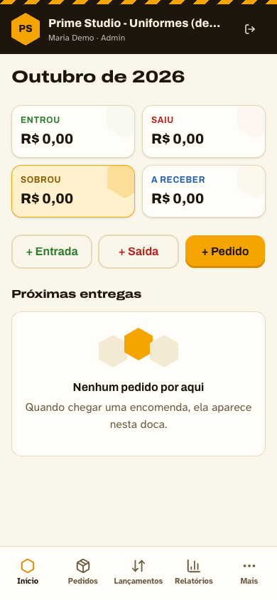
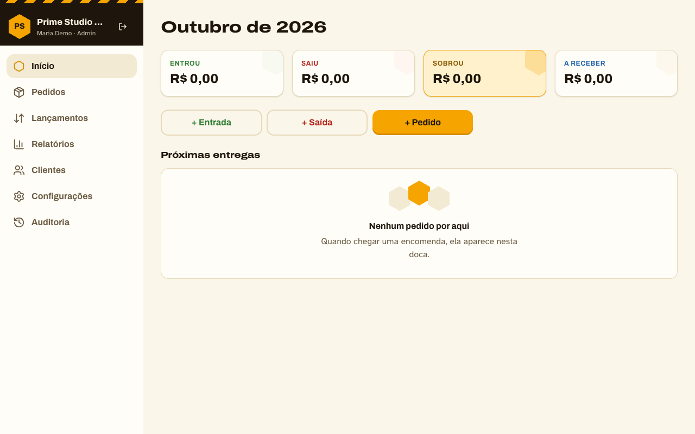
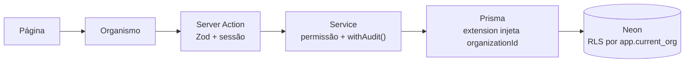

# BeeDock

Gestão de pedidos, entradas e saídas para pequenas estamparias (serigrafia, sublimação, DTF, canecas, bolsas e bonés).
Sistema web responsivo e mobile-first, com várias empresas isoladas por Row Level Security e auditoria imutável.

[](https://github.com/natanoliveira/beedock/actions/workflows/ci.yml)
[](LICENSE)


## Telas

| Entrar | Início (celular) | Início (desktop) |
|---|---|---|
|  |  |  |

## Funcionalidades

Estado atual: **Fase 4 — Clientes e pedidos** (sobre os lançamentos da Fase 3, a fundação da Fase 1 e o painel da Fase 2).

- Login por e-mail e senha, com bloqueio após 5 tentativas, limite por IP e sessão revogável que expira por inatividade
- Várias empresas com isolamento em duas camadas (aplicação + RLS no PostgreSQL)
- Auditoria append-only com encadeamento SHA-256 por empresa e verificação por script
- Design system "Colmeia & Doca" em Atomic Design, menu no topo com gaveta no celular e barra de progresso de navegação

- Lançamentos de entrada e saída (valor em centavos), com categoria, forma de pagamento, filtros por mês, tipo e categoria, edição e exclusão auditadas
- Mês financeiro com dia de início configurável pela empresa (ex.: de 5/10 a 4/11)
- Categorias e formas de pagamento por empresa (criar, renomear, desativar), gerenciadas pelo Admin
- Comprovante privado: a imagem é reduzida no navegador e normalizada no servidor com `sharp`; PDFs também são aceitos. O arquivo vai para o Vercel Blob em modo private e só é entregue por uma rota autenticada que confere a empresa do usuário
- Recibo em PDF do lançamento, gerado com `pdf-lib`
- Barra de progresso fina no topo durante a navegação entre telas
- Clientes: cadastro com busca por nome ou WhatsApp, link para o WhatsApp, exclusão (só sem pedidos), anonimização LGPD com motivo e lista "Para revisar" pelo prazo de retenção da empresa
- Pedidos: um item por pedido (tipo de produto, descrição, total e entrega), situação Aberto, Pronto, Entregue ou Cancelado, numeração por empresa (#N), sinal na criação e cliente novo na própria tela
- Recebimentos ligados aos lançamentos: cada recebimento cria, edita e exclui o lançamento de entrada na mesma transação, com a soma limitada ao total do pedido
- Cancelamento com estorno (de R$ 0,01 até o recebido), que gera uma saída em Lançamentos sem apagar os recebimentos
- Início com "A receber (hoje)" e "Próximas entregas"; tipos de produto gerenciados pelo Admin
- Recibo do pedido em PDF (recebimentos, total, saldo, "QUITADO" ou "CANCELADO")

Próximas fases: relatórios, auditoria, histórico e exportação LGPD, PWA (veja o Roadmap).

## Stack

| Tecnologia | Uso |
|---|---|
| Next.js 16 (App Router) | Frontend e backend (Server Actions) |
| TypeScript strict | Tipagem, sem `any` |
| PostgreSQL no Neon + Prisma 7 | Banco, migrations, driver adapter `@prisma/adapter-neon` |
| Zod | Validação de formulários, actions e variáveis de ambiente |
| Auth.js v5 | Login por credenciais; o JWT carrega só o id da sessão |
| Argon2id (`@node-rs/argon2`) | Hash de senhas |
| Tailwind CSS 4 + shadcn/ui | Interface e tokens de tema |
| `pdf-lib` | Geração do recibo em PDF |
| `sharp` | Validação e normalização de imagens de comprovante e logo |
| Vercel Blob (private) | Armazenamento de comprovantes e logos |
| Vitest | Testes de regras e de isolamento entre empresas |
| ESLint + `eslint-plugin-boundaries` + Prettier | Qualidade e camadas do Atomic Design |
| Vercel | Hospedagem |

## Arquitetura

```
app/            rotas: (auth) login · (app) área da empresa · (plataforma) painel MASTER
components/     ui/ (shadcn) → atoms/ → molecules/ → organisms/ → templates/
features/       actions e services por domínio (auth, organizations…)
lib/            db, tenant, audit, auth, session, permissions, env, logger
prisma/         schema, migrations (inclui RLS e trigger da auditoria), seed
scripts/        create-admin, create-org, audit-verify
tests/          isolamento entre empresas contra banco real
```



**Atomic Design.** Cada camada só importa as de baixo. O ESLint barra, por exemplo, uma página que importa `components/ui` direto ou uma molécula que importa um organismo.

**Multi-empresa.** Toda tabela de negócio tem `organizationId`, e as chaves estrangeiras entre elas são compostas (`organizationId` + id), então nenhuma empresa referencia registro de outra. O acesso passa por `withScope()` (`lib/db.ts`), que abre uma transação, executa `set_config('app.current_org', …, true)` e ativa a extension que injeta `organizationId` em todo filtro. A aplicação conecta com o papel `beedock_app`, que não é dono das tabelas, então as policies de RLS valem sempre. A aplicação recusa rodar se `DATABASE_URL` usar um papel que ignora RLS. Os testes em `tests/isolation.test.ts` provam que a empresa B não lê, não altera e não exclui dados da empresa A, nem por SQL cru.

**Auditoria.** `withAudit()` (`lib/audit.ts`) grava o evento na mesma transação da alteração. Um advisory lock por empresa serializa a cadeia, e cada evento guarda o HMAC-SHA256 (chave `AUDIT_HMAC_KEY`, fora do banco) que encadeia o anterior. Quem tem acesso só ao Postgres não consegue recalcular a cadeia. A tabela não aceita `UPDATE`, `DELETE` nem `TRUNCATE` (sem grant e com trigger). `pnpm audit:verify` valida as cadeias.

## Segurança e LGPD

- Senhas com Argon2id. Bloqueio de 15 min após 5 falhas. Limite de 20 falhas por IP em 15 min.
- Sessão no banco (tabela `Session`): revogável, com expiração absoluta de 7 dias e por inatividade (padrão de 60 min, configurável por empresa).
- Cookies `httpOnly`, `secure` em produção, `sameSite=lax` (padrão do Auth.js).
- Headers de segurança: CSP, HSTS, X-Frame-Options, nosniff e Referrer-Policy (`next.config.ts`).
- Logs passam por `lib/logger.ts`, que mascara CPF, CNPJ, telefone e e-mail. A auditoria nunca grava senha, token ou hash, e mascara dados pessoais.
- **Onde os dados ficam:** PostgreSQL no Neon, região AWS `us-east-1` (Virgínia do Norte, EUA). As funções rodam na Vercel em `iad1`, na mesma região. Para hospedar no Brasil, crie o projeto Neon em `aws-sa-east-1` (São Paulo) e troque a região em `vercel.json` para `gru1`.

## Como rodar localmente

Pré-requisitos: Node 22 (`nvm use`), pnpm 9 e um projeto no Neon com uma branch `dev`.

```bash
git clone https://github.com/natanoliveira/beedock.git && cd beedock
nvm use
pnpm install
cp .env.example .env            # preencha DIRECT_URL (papel dono, host sem -pooler), AUTH_SECRET e AUDIT_HMAC_KEY
pnpm db:migrate                 # cria tabelas, RLS, papel beedock_app e trigger da auditoria
```

Defina a senha do papel da aplicação no SQL Editor do Neon:

```sql
ALTER ROLE beedock_app WITH LOGIN PASSWORD 'uma-senha-forte';
```

Coloque em `DATABASE_URL` a URL **pooled** (host com `-pooler`) usando `beedock_app` e essa senha. Depois:

```bash
pnpm db:seed          # 3 empresas fictícias, sem usuários (+ MASTER se SEED_MASTER_* definido)
pnpm create-admin     # usuário MASTER (pede a senha no terminal)
pnpm create-org       # empresa + Admin da empresa
pnpm dev              # http://localhost:3004
```

## Painel da plataforma

- `/plataforma` (empresas): o MASTER lista, cria, edita, suspende e reativa empresas.
- Ao criar a empresa é gerado um convite por link, válido por 48 horas, exibido uma única vez; pode ser reenviado (revoga o anterior).
- `/convite/[token]`: o Admin da empresa define a senha e acessa o sistema.

## Variáveis de ambiente

| Nome | Descrição | Onde obter |
|---|---|---|
| `DATABASE_URL` | Conexão pooled com o papel `beedock_app` (sujeita a RLS) | Neon › Connect › pooled; usuário `beedock_app` |
| `DIRECT_URL` | Conexão direta com o papel dono (migrations, seed, scripts) | Neon › Connect › sem pooling |
| `AUTH_SECRET` | Chave de assinatura do JWT (32+ caracteres) | `openssl rand -base64 32` |
| `AUTH_URL` | URL pública da aplicação | `http://localhost:3004` ou o domínio na Vercel |
| `AUDIT_HMAC_KEY` | Chave HMAC da cadeia de auditoria. Fica só na aplicação, nunca no banco | `openssl rand -base64 32` |
| `BLOB_READ_WRITE_TOKEN` | Necessário para enviar comprovantes e logos: use um token real de um Blob store (um valor falso faz o upload falhar). Sem ele o upload fica indisponível, o resto do app funciona | Vercel › Storage › Blob |
| `SEED_MASTER_NAME` / `SEED_MASTER_EMAIL` / `SEED_MASTER_PASSWORD` | Opcionais, juntos: o `db:seed` cria ou promove o MASTER | Você define |
| `ENABLE_SIGNUP` | Cadastro público (desligado) | `false` |
| `TEST_DATABASE_URL` / `TEST_DIRECT_URL` | Banco dos testes de isolamento (opcional) | Branch de teste do Neon |

## Scripts disponíveis

| Script | O que faz |
|---|---|
| `pnpm dev` | Servidor de desenvolvimento |
| `pnpm build` | Build de produção |
| `pnpm lint` / `pnpm typecheck` | ESLint (inclui as camadas) / TypeScript |
| `pnpm test` | Vitest. Os testes de isolamento rodam quando `TEST_*_URL` está definida |
| `pnpm db:migrate` | `prisma migrate deploy` |
| `pnpm db:seed` | Empresas fictícias com os cadastros padrão. Também cria/promove o MASTER a partir de `SEED_MASTER_NAME/EMAIL/PASSWORD` (pula se ausentes). Recria configurações que faltarem. `PRUNE_CONFIRM=<host do DIRECT_URL> pnpm db:seed -- --prune` (só fora de produção; sem a confirmação do host não apaga nada) apaga as empresas que não são do seed e os usuários que ficam sem vínculo |
| `pnpm create-admin` | Cria ou atualiza o usuário MASTER |
| `pnpm create-org` | Cria uma empresa e o Admin dela |
| `pnpm audit:verify` | Verifica a cadeia de hash da auditoria |

## Deploy

1. Na Vercel, importe o repositório e adicione a integração **Neon** (Marketplace): branch `main` para produção e uma branch automática por Pull Request.
2. Configure as variáveis da tabela acima. `DATABASE_URL` usa `beedock_app`; `DIRECT_URL` usa o papel dono.
3. O script `vercel-build` roda `prisma generate && prisma migrate deploy && next build`. Nunca use `migrate dev` em produção.
4. A região das funções está em `vercel.json` e deve ser a mesma do banco.
5. Depois do primeiro deploy, rode `ALTER ROLE beedock_app …` no banco de produção e `pnpm create-admin` apontando para ele.

## Backup e restauração

O Neon mantém histórico para point-in-time restore (a janela depende do plano). Para restaurar:

1. Neon › Branches › **Restore**, escolhendo data e hora. Faça antes numa branch nova e confira os dados.
2. Valide a auditoria com `DIRECT_URL=<branch restaurada> pnpm audit:verify`.
3. Promova a branch, ou aponte `DATABASE_URL`/`DIRECT_URL` para ela, e faça um novo deploy.

## Roadmap

- [x] Fase 1: fundação (auth, RLS, auditoria, design system, layout responsivo, CI)
- [ ] Fase 2: painel da plataforma, configurações da empresa, funcionários e convites, aceite de termos
- [x] Fase 3: lançamentos com comprovante privado, recibo em PDF, mês financeiro, categorias e formas de pagamento, filtros
- [x] Fase 4: clientes (LGPD) e pedidos com recebimentos
- [ ] Fase 5: Início, relatório mensal (PDF/CSV) e telas de auditoria
- [ ] PWA: manifest, instalação no Android e no iPhone, modo offline

## Licença

[MIT](LICENSE)
