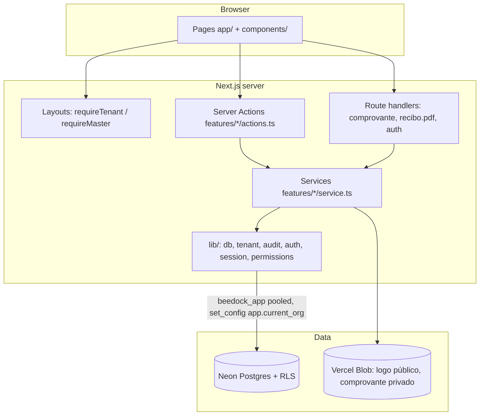
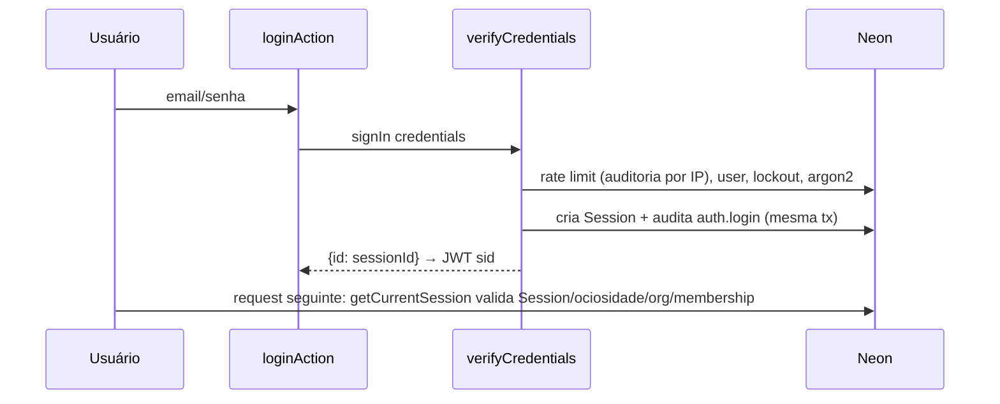
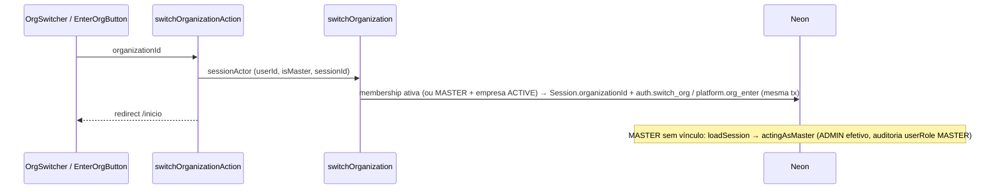
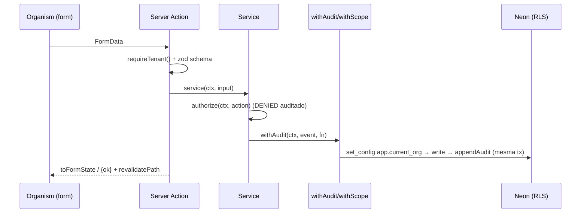

# Codebase Map

> Auto-generated by Cartographer. Last mapped: 2026-10-22T15:56:09Z

BeeDock: SaaS multiempresa de gestão para estamparias. Next.js 16 (App Router, `cacheComponents:false`) + Prisma 7 (adapter Neon) + Auth.js v5 (Credentials/JWT) + Postgres RLS + auditoria append-only em cadeia HMAC. UI pt-BR, Atomic Design imposto por lint, design system "Colmeia & Doca".

## System Overview



## Directory Structure

```
app/                     rotas (App Router)
  (auth)/                login, convite/[token] (caixa de aceite dos termos), aceite (termos pendentes; sem guard de termos) — AuthTemplate 50/50
  (public)/              termos, privacidade — públicas, dinâmicas (`await connection()`), mostram a versão vigente ou "Documento ainda não publicado."
  (app)/                 área da empresa — layout chama requireTenant()
    inicio/ lancamentos/ (+[id]/comprovante, [id]/recibo.pdf route handlers)
    configuracoes/ (empresa=ADMIN, categorias, formas-de-pagamento, tipos-de-produto, equipe=ADMIN, auditoria=placeholder)
    clientes/ (+[id]) pedidos/ (+[id], [id]/recibo.pdf route handler)   Fase 4
    relatorios/   placeholder (Fase 5)
  (plataforma)/plataforma/  painel MASTER — layout chama requireMaster(); empresas/, usuarios/ (+[id]), termos/ (publicar Termos/Privacidade, versão vigente e nº de aceites)
  api/auth/[...nextauth]/   único API route
features/                domínio (sem importar components/app — lint)
  auth/ platform/ members/ transactions/ customers/ orders/ catalog/ organizations/ (service, logo, actions, schemas, defaults) legal/ (service, rules, schemas, templates, actions) shared/
lib/                     infraestrutura (db, tenant, audit, auth, session, permissions, env, logger…)
components/              Atomic Design: ui (shadcn cru) → atoms → molecules → organisms → templates
hooks/use-media-query.ts único hook
prisma/                  schema, migrations (init, rls_audit, composite_fk, payer, membership_rls, legal_append_only, orders_customers), seed.ts
scripts/                 create-admin, create-org, audit-verify (DIRECT_URL, owner)
tests/                   integração Neon (isolation, platform, catalog, transactions, customers, orders, order-payments, order-cancel, order-queries, order-receipt, orders-migration)
docs/superpowers/        specs + planos Fase 2a, Fase 3 e Usuários/acesso do MASTER; docs/screenshots
previews/                HTML estático de design (lint-ignored)
prompt-beedock.md        spec original do produto
```

## Module Guide

### lib/ — núcleo
| Arquivo | Papel |
|---|---|
| `db.ts` | PrismaClient + extensão: model tenant fora de `withScope` lança; `withScope(scope, fn)` = `$transaction` + `set_config('app.current_org'|'app.platform', …, true)`; `assertRlsRole()` falha se role ignora RLS |
| `tenant.ts` | `TENANT_MODELS`, `scopeArgs` (força `organizationId` no where, bloqueia org divergente no data), `TenantViolationError` |
| `audit.ts` | `appendAudit` (advisory lock por org, prevHash, HMAC-SHA256, `sanitize`), `withAudit(ctx, event, fn)` (escrita + auditoria na mesma tx), `recordAudit`, `authorize` (DENIED auditado + `ForbiddenError`), `diff`; `appendPlatformAudit(tx, actor, event)` (evento de plataforma `organizationId: null` dentro de tx de empresa: salva `app.platform`, liga, grava e RESTAURA o valor anterior; se o append falhar, o restore é best-effort e o erro original sobe — tx abortada 25P02 não o mascara); `Actor.auditRole` sobrescreve o `userRole` gravado (MASTER agindo como ADMIN) |
| `auth.ts` | Auth.js v5 Credentials; JWT guarda só `sid` |
| `session.ts` | `loadSession(sid)` (valida Session, ociosidade, org ACTIVE, membership; MASTER sem vínculo na empresa = `actingAsMaster`, papel ADMIN efetivo), `getCurrentSession` (React cache sobre `loadSession`), `toTenantContext(session, meta)` (preenche `auditRole: "MASTER"` quando `actingAsMaster`), `requireAcceptedSession` (sem sessão → /login; `pendingTerms` → /aceite; MASTER nunca fica pendente), `requireTenant` (usa o anterior), `requireMaster`; `CurrentSession.pendingTerms` (via `hasPendingLegalDocuments`, em `Promise.all` com o toque de `lastSeenAt`) |
| `permissions.ts` | matriz RBAC ADMIN/FUNCIONARIO, `can`, `ForbiddenError` |
| `request.ts` | `requestMeta`: ip (x-real-ip → x-forwarded-for), userAgent, requestId |
| `env.ts` | zod das envs (lança no import) |
| `timezones.ts` | fusos do Brasil (`BR_TIMEZONES`: valor IANA + rótulo acentuado com UTC), `timezoneOptions(current)` mantém fuso legado |
| `blob.ts` | `blobToken`/`blobUploadEnabled` (formato do token Vercel Blob, fonte única) |
| `form-state.ts` | `FormState`, `toFormState`, `plainValues` — compartilhado pelas actions |
| `logger.ts` | JSON + `maskPii` |
| `document.ts`, `color.ts`, `format-date.ts`, `resize-image.ts`, `utils.ts` | helpers |

### features/
- **auth/**: `loginAction`, `logoutAction`; `verifyCredentials` (rate limit 20 falhas/IP/15min via auditoria, lockout 5 tentativas/15min, hash dummy constante, Session 7d; entra na empresa da Session mais recente por `lastSeenAt`, sem histórico no vínculo mais antigo), `revokeSession`, `hashPassword` (Argon2id).
- **members/** (equipe): `service.ts` (`listTeam`, `changeMemberRole`, `setMemberActive`, `linkUser`, `inviteMember`, `revokeInvitation`; `assertCanManage` = ADMIN da empresa ou MASTER; guarda do último Admin ativo com `FOR UPDATE` → `LAST_ADMIN`; `ALREADY_MEMBER`, `USER_NOT_FOUND`); `switch.ts` (`listOrganizationOptions`, `switchOrganization` → `auth.switch_org`, `leaveOrganization`; MASTER entra/sai de qualquer empresa ACTIVE → `platform.org_enter`/`platform.org_leave`); `actions.ts` (invite/link/role/active/revoke com `organizationId` null = empresa da sessão, senão MASTER; `findUserByEmailAction`); `schemas.ts`.
- **platform/** (MASTER): CRUD de empresa, convite Admin 48h (token só hash SHA-256), suspender/reativar (revoga sessões), logo; `invitations.ts` (público, rate limit); `errors.ts` (`FieldError`, `NotFoundError`); `seed-master.ts`; `invite-flash.ts` (cookie httpOnly 5min); `users.ts` (`listUsers` com busca/filtro por empresa/paginação 50, `getUser`, `findUserByEmail`; tudo em `withScope({ platform: true })`). Convite aceita papel ADMIN ou FUNCIONARIO; e-mail já cadastrado exige a senha atual e vincula (`/convite/[token]`); criar empresa com e-mail existente vincula como Admin sem convite.
- **transactions/**: `service.ts` (list paginado 50, `monthSummary`, create/update/delete soft, `keepPayerDocument`); `period.ts` (mês financeiro c/ dia inicial + timezone); `money.ts` (`parseBrl`, `valorPorExtenso`); `storage.ts` (Blob privado, magic bytes, `ownsPath`); `receipt*.ts` (PDF pdf-lib, emissão auditada).
- **catalog/**: categorias + formas de pagamento + tipos de produto (ADMIN, `settings.manage`), duplicata case-insensitive, sugestão de reativar; categoria com `systemKey` (Pedidos/Estorno) renomeia mas não desativa.
- **customers/**: `service.ts` (`listCustomers` com busca e saldo/em andamento sem N+1, `getCustomer`, `customerOptions`, `createCustomer`/`createCustomerInTx` (pedido com cliente novo), `updateCustomer`, `deleteCustomer` (recusa com pedidos), `anonymizeCustomer` (recusa com pedido OPEN/READY; limpa `payerName/payerDocument` dos lançamentos ligados; auditoria com motivo, `before` sem PII), `listCustomersForReview` (retenção, Admin)); `rules.ts` (`anonymizedName`); `schemas.ts`; `actions.ts`. Auditoria guarda `hasNote`, nunca a observação.
- **orders/**: `service.ts` (`createOrder` com lock `pg_advisory_xact_lock('order:'+org)` para `Order.number`, cliente inline e sinal na mesma tx; `updateOrder`, `changeOrderStatus` (grava `deliveredOn` no fuso da empresa), `deleteOrder`, `cancelOrder` (estorno obrigatório se há recebido → saída `ORDER_REFUND`)); `payments.ts` (`registerPayment`/`updatePayment`/`deletePayment`/`createLinkedPayment`: recebimento + lançamento INCOME `ORDER_PAYMENT` na mesma tx sob `SELECT … FOR UPDATE` do pedido; Σ recebimentos ≤ total; cancelado/excluído recusa); `queries.ts` (`listOrders`, `getOrder`, `amountToReceive`, `upcomingDeliveries`, `orderFormOptions`); `rules.ts` (`canTransition`, saldo, prazo); `receipt.ts`/`receipt-pdf.ts` (recibo do pedido, audita `order.receipt_issue`); `view.ts` (`toViewRow`); `schemas.ts` (campos planos do FormData → objetos aninhados).
- **transactions/pdf-kit.ts**: cabeçalho da empresa, logo, `safeText`, `wrap`, `beginDocument` compartilhados pelos recibos.
- **organizations/** (empresa): `service.ts` (`getCompanySettings`, `updateCompanySettings`, `setCompanyLogo` com `FOR UPDATE` na linha da empresa: uploads simultâneos devolvem o `previous` certo e nenhum blob fica órfão; `organization.update` auditado com `userRole` correto), `logo.ts` (`storeLogo`/`deleteLogoBlob`), `actions.ts` (`updateCompanySettingsAction`, upload/remove de logo), `schemas.ts` (`companySettingsSchema` = organizationSchema sem slug).
- **legal/**: `service.ts` (`currentLegalDocuments`, `pendingLegalDocumentsFor`, `hasPendingLegalDocuments` (hot path: 1 query SQL só com ids, mesmo predicado, teste de concordância), `acceptLegalDocumentsTx`, `publishLegalDocumentTx` + variantes não-Tx, `legalOverview`), `rules.ts` (`pendingDocuments`), `schemas.ts` (recusa `[PREENCHER`), `templates.ts`, `actions.ts` (`acceptTermsAction`, `publishLegalDocumentAction`). Eventos `platform.legal_publish` e `auth.terms_accept` na cadeia da plataforma.
- **organizations/defaults.ts**: `seedOrganizationDefaults(tx, orgId, settings)` — settings, categorias, formas de pagamento, tipos de produto.

### components/ — camadas (eslint-plugin-boundaries)
| De | Proibido importar |
|---|---|
| atom | molecule, organism, template, feature, page |
| molecule | ui, organism, template, feature, page |
| organism | ui, template, feature, page |
| template | ui, feature, page |
| page (app) | ui |
| feature | components/*, app |

- **atoms**: `AppButton` (cva tone/size, ≥44px), aliases `AppDialog/AppDrawer/AppSheet/AppDropdownMenu`, `AppInput/Label/Skeleton/Toaster/Select` (native), `HexMark`, `MoneyText` (`formatCents`), `StatusBadge`, `OrgStatusBadge`, `NavigationProgress` (+`startNavigationProgress()`/`stopNavigationProgress()`).
- **molecules**: `ConfirmAction` (Dialog/Drawer + motivo), `EmptyState`, `AdminOnlyNotice`, `FormField`, `KpiCard`, `MoneyInput`, `LogoDropzone` (crop WebP), `LogoutButton`, `ReceiptActions`, `InviteLink` (link de convite + copiar), `EnterOrgButton` (MASTER entra na empresa).
- **organisms**: `TransactionForm` (~4.6k tok), `TransactionList` (+RowActions), `OrganizationForm` (+`values.ts` testado), `AppNavigation` (menu Empresa ▸ Equipe só ADMIN; `OrgSwitcher` no topo), `OrgSwitcher` (dropdown "Trocar empresa", busca local > 8 opções), `MasterBanner` ("Você está como MASTER…" + Voltar à plataforma), `TeamManager` (equipe + convites, Dialog/Drawer; reusado em `/configuracoes/equipe` e na empresa do MASTER), `UserList` e `UserMemberships` (`/plataforma/usuarios` e detalhe), `PlatformNav`, `CatalogTable`, `OrganizationList`, `LoginForm`, `AcceptInviteForm` (senha nova ou senha atual), `OrgHeader`, `LegalDocumentView` (`heading` h1 nas páginas públicas, h2 no aceite), `TermsAcceptForm` (aceite em `/aceite`), `LegalPublisher` (MASTER publica versão), `OrganizationForm mode="tenant"` (Empresa pelo Admin, sem slug), molecule `LegalLinks`, `LogoDropzone.removeAction`, `OrgAccount`, `QuickActions`.
- **templates**: `AppShellTemplate` (header topo `bg-ink` + faixa `.tape`, max-w 1240), `AuthTemplate` (50/50).
- Organisms recebem server actions como props; nunca importam `features/`.

## Data Model

- **Globais (sem RLS)**: `Organization`, `User` (platformRole USER|MASTER, lockout), `Session`, `LegalDocument/Acceptance` (append-only: `beedock_app` sem UPDATE/DELETE/TRUNCATE, como `AuditLog`).
- **RLS `tenant_or_platform`**: `Membership` (user×org, role ADMIN|FUNCIONARIO, active; login lê no escopo da plataforma), `SupportAccessGrant` (sem uso).
- **Pedidos**: `Order.number` único por empresa; `Transaction.orderId` liga recebimento (INCOME) e estorno (EXPENSE) ao pedido (FK composta); `Category.systemKey` (`ORDER_PAYMENT`/`ORDER_REFUND`) identifica as categorias do sistema; CHECK `> 0` em `Order.totalCents` e `OrderPayment.amountCents`.
- **Tenant (RLS `tenant_isolation`)**: OrganizationSettings, Invitation (`tenant_or_platform`), Customer, ProductType, Category, PaymentMethod, Order, OrderPayment, Transaction. `organizationId` default = `current_setting('app.current_org')`. FKs compostas `(organizationId, xId)` impedem referência cross-tenant.
- **AuditLog**: RLS SELECT/INSERT, UPDATE/DELETE/TRUNCATE revogados + triggers imutáveis; uma cadeia por org + cadeia plataforma (`organizationId` null).

## Data Flow

### Login e request autenticada

Login cai na empresa da Session mais recente (`lastSeenAt desc`); sem histórico, no vínculo mais antigo.

### Troca de empresa / MASTER na empresa


### Escrita (padrão)


### Aceite de termos
Publicar versão (MASTER, `/plataforma/termos`) cria `LegalDocument` + `platform.legal_publish`. Todo guard `requireAcceptedSession` calcula `pendingTerms` (versão vigente sem `LegalAcceptance` do usuário; MASTER isento) e redireciona a `/aceite`; `acceptTermsAction` grava `LegalAcceptance` + `auth.terms_accept` (via `appendPlatformAudit`) e vai a `/inicio`. Convite exige a caixa de aceite quando há documento publicado (erro `terms`); a conta e o aceite saem na mesma tx. `/aceite` e `logoutAction` não passam pelo guard de termos.

## Conventions

- Proteção de rota só em layouts/pages/actions/route handlers (`requireTenant`/`requireMaster`) — **não há middleware/proxy**. Toda página, action e route handler nova chama o guard.
- Toda escrita: `authorize` → `withAudit`. Leitura de model tenant só dentro de `withScope`.
- Dinheiro em centavos inteiros; datas `@db.Date` UTC meia-noite; soft delete (`deletedAt`).
- Actions retornam `FormState` (`fieldErrors` com nomes dos campos, `values` para repopular); `unstable_rethrow` para redirect.
- UI: tokens CSS (`bg-primary`, `text-income`), cva, Dialog no desktop / Drawer no mobile via `useMediaQuery`, `motion-reduce`, copy pt-BR. `--primary` sobrescrito pela cor da empresa no shell.
- Commits: Conventional Commits em português, sem atribuição de IA.

## Gotchas

- RLS habilitado mas **não FORCE** na migration `rls_audit`; papel owner ignora — app protegido por `assertRlsRole()` (conectar com `beedock_app`).
- `Session`, `User`, `Organization` sem RLS — consultáveis via `db.x` fora de `withScope`. `include: { memberships }` fora de `withScope` volta vazio (RLS).
- Último Admin ativo: `changeMemberRole`/`setMemberActive` travam as memberships ADMIN da empresa com `FOR UPDATE` e recusam com `LAST_ADMIN` (concorrência segura).
- MASTER sem vínculo na empresa = ADMIN efetivo (`actingAsMaster`) com auditoria `userRole = 'MASTER'` (`Actor.auditRole`); MASTER entra só em empresa ACTIVE e sai com `platform.org_leave`.
- Upload de Blob fora da tx do banco → blobs órfãos possíveis se o processo cair; edição de lançamento trava a linha (`FOR UPDATE`) contra troca concorrente de comprovante.
- Logo sempre `.webp` no path; `ENABLE_SIGNUP` validado mas sem uso.
- `NavigationProgress`: destino igual à URL atual não inicia a barra; `router.push` programático/server action com redirect precisa `startNavigationProgress(href)` e, se falhar, `stopNavigationProgress()`; o listener de click é registrado na fase de captura (a raiz do React é `document` e o `Link` faz `preventDefault`); cores fixas.
- `pnpm db:seed -- --prune` apaga empresas fora da lista do seed (sobras de teste/QA) e usuários que ficam sem vínculo; recusado em produção e exige `PRUNE_CONFIRM=<host do DIRECT_URL>`.
- **Testes de integração rodam no MESMO banco do dev** (`TEST_DATABASE_URL`=`DATABASE_URL`): ids escalares nas limpezas de `afterAll` começam como `""`, nunca `undefined` — `where: { x: undefined }` no Prisma remove o filtro e apaga a tabela inteira.
- Testes de integração pulam silenciosamente sem `TEST_DATABASE_URL`/`TEST_DIRECT_URL`; ambiente vitest `node` (sem DOM).
- Lançamento com `orderId` não é editável nem excluível por `updateTransaction`/`deleteTransaction` (`RuleError`); a tela de Lançamentos mostra o selo "Pedido #N" e leva ao pedido. `RuleError` (features/platform/errors.ts) vira erro de formulário em `toFormState`.
- `AppNavigation` linka Relatórios (placeholder, Fase 5).
- `pnpm audit:verify` reporta 5 eventos legados (SHA-256, seq 1–5 de uma empresa antiga do dev): conhecidos, ficam; decisão de limpar segue em aberto.
- Dark mode só via `prefers-color-scheme`.
- Node ≥22.12 obrigatório (Neon WebSocket falha em 20). Porta dev 3004.

- Evento de plataforma (`organizationId: null`) dentro de tx de empresa só via `appendPlatformAudit` (restaura `app.platform` ao fim; não deixar o escopo ligado).
- **Testes nunca publicam `LegalDocument` fora de rollback** (`withScope({platform:true}, …throw ROLLBACK)`): uma versão publicada bloqueia todos os usuários do dev em `/aceite`.
- Páginas públicas que leem o banco (`/termos`, `/privacidade`) são dinâmicas (`await connection()`), senão o build pré-renderiza com acesso ao banco.

## Navigation Guide

- **Nova tela da empresa**: `app/(app)/<rota>/page.tsx` (+`loading.tsx`) chamando `requireTenant()`; link em `components/organisms/AppNavigation`; permissão em `lib/permissions.ts`.
- **Nova escrita**: schema em `features/<x>/schemas.ts` → service com `authorize` + `withAudit` → action fina com `toFormState` → organism recebe action por prop → teste em `tests/<x>.test.ts`.
- **Novo model tenant**: `prisma/schema.prisma` + migration com policy RLS e FK composta + adicionar em `lib/tenant.ts` `TENANT_MODELS`.
- **Auth/sessão**: `lib/auth.ts`, `lib/session.ts`, `features/auth/service.ts`.
- **Painel MASTER**: `app/(plataforma)/`, `features/platform/` (usuários: `users.ts`); equipe e troca de empresa: `features/members/`.
- **Componente**: camada certa em `components/`, respeitar tabela de boundaries; wrappers de ui em atoms.
- **Auditoria**: `lib/audit.ts`; verificar cadeia `pnpm audit:verify`.
