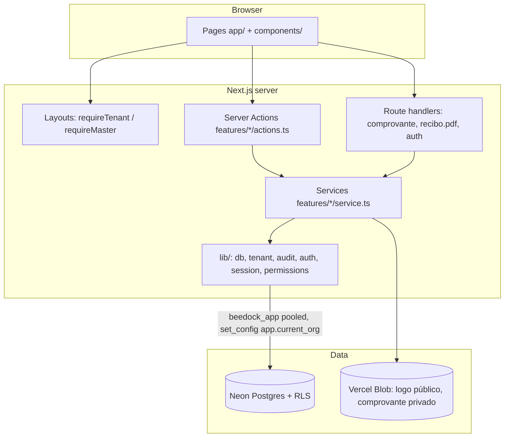
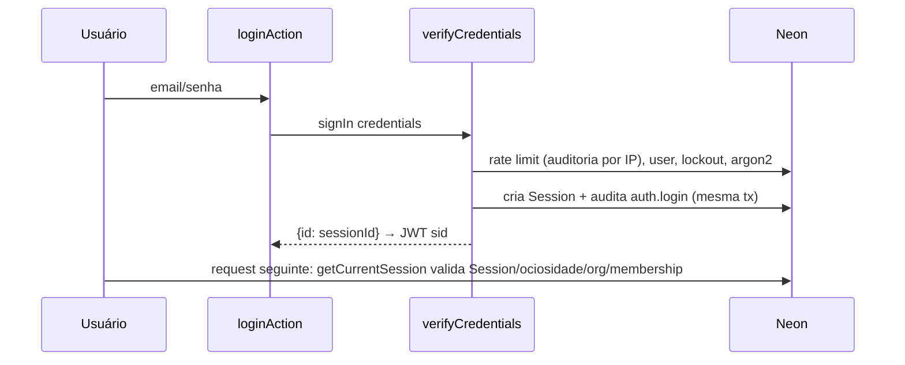
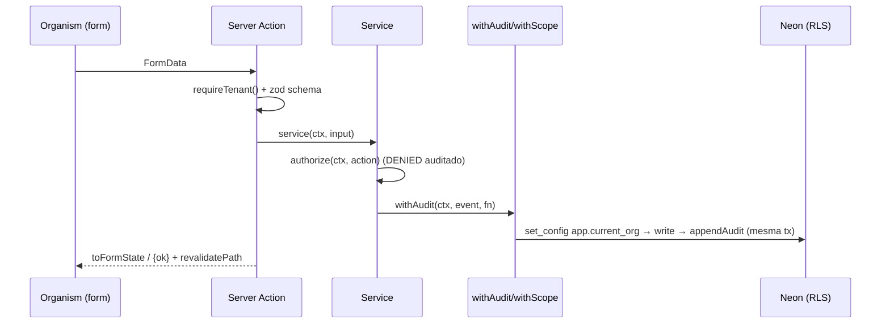

# Codebase Map

> Auto-generated by Cartographer. Last mapped: 2026-10-22T12:02:41Z

BeeDock: SaaS multiempresa de gestão para estamparias. Next.js 16 (App Router, `cacheComponents:false`) + Prisma 7 (adapter Neon) + Auth.js v5 (Credentials/JWT) + Postgres RLS + auditoria append-only em cadeia HMAC. UI pt-BR, Atomic Design imposto por lint, design system "Colmeia & Doca".

## System Overview



## Directory Structure

```
app/                     rotas (App Router)
  (auth)/                login, convite/[token]  — públicas, AuthTemplate 50/50
  (app)/                 área da empresa — layout chama requireTenant()
    inicio/ lancamentos/ (+[id]/comprovante, [id]/recibo.pdf route handlers)
    configuracoes/ (categorias, formas-de-pagamento, auditoria=placeholder)
    clientes/ pedidos/ relatorios/   placeholders (Fases 4–5)
  (plataforma)/plataforma/  painel MASTER — layout chama requireMaster()
  api/auth/[...nextauth]/   único API route
features/                domínio (sem importar components/app — lint)
  auth/ platform/ transactions/ catalog/ organizations/ shared/
lib/                     infraestrutura (db, tenant, audit, auth, session, permissions, env, logger…)
components/              Atomic Design: ui (shadcn cru) → atoms → molecules → organisms → templates
hooks/use-media-query.ts único hook
prisma/                  schema, migrations (init, rls_audit, composite_fk, payer), seed.ts
scripts/                 create-admin, create-org, audit-verify (DIRECT_URL, owner)
tests/                   integração Neon (isolation, platform, catalog, transactions)
docs/superpowers/        specs + planos Fase 2a e Fase 3; docs/screenshots
previews/                HTML estático de design (lint-ignored)
prompt-beedock.md        spec original do produto
```

## Module Guide

### lib/ — núcleo
| Arquivo | Papel |
|---|---|
| `db.ts` | PrismaClient + extensão: model tenant fora de `withScope` lança; `withScope(scope, fn)` = `$transaction` + `set_config('app.current_org'|'app.platform', …, true)`; `assertRlsRole()` falha se role ignora RLS |
| `tenant.ts` | `TENANT_MODELS`, `scopeArgs` (força `organizationId` no where, bloqueia org divergente no data), `TenantViolationError` |
| `audit.ts` | `appendAudit` (advisory lock por org, prevHash, HMAC-SHA256, `sanitize`), `withAudit(ctx, event, fn)` (escrita + auditoria na mesma tx), `recordAudit`, `authorize` (DENIED auditado + `ForbiddenError`), `diff` |
| `auth.ts` | Auth.js v5 Credentials; JWT guarda só `sid` |
| `session.ts` | `getCurrentSession` (React cache; valida Session, ociosidade, org ACTIVE, membership), `requireTenant`, `requireMaster` |
| `permissions.ts` | matriz RBAC ADMIN/FUNCIONARIO, `can`, `ForbiddenError` |
| `request.ts` | `requestMeta`: ip (x-real-ip → x-forwarded-for), userAgent, requestId |
| `env.ts` | zod das envs (lança no import) |
| `blob.ts` | `blobToken`/`blobUploadEnabled` (formato do token Vercel Blob, fonte única) |
| `form-state.ts` | `FormState`, `toFormState`, `plainValues` — compartilhado pelas actions |
| `logger.ts` | JSON + `maskPii` |
| `document.ts`, `color.ts`, `format-date.ts`, `resize-image.ts`, `utils.ts` | helpers |

### features/
- **auth/**: `loginAction`, `logoutAction`; `verifyCredentials` (rate limit 20 falhas/IP/15min via auditoria, lockout 5 tentativas/15min, hash dummy constante, Session 7d), `revokeSession`, `hashPassword` (Argon2id).
- **platform/** (MASTER): CRUD de empresa, convite Admin 48h (token só hash SHA-256), suspender/reativar (revoga sessões), logo; `invitations.ts` (público, rate limit); `errors.ts` (`FieldError`, `NotFoundError`); `seed-master.ts`; `invite-flash.ts` (cookie httpOnly 5min).
- **transactions/**: `service.ts` (list paginado 50, `monthSummary`, create/update/delete soft, `keepPayerDocument`); `period.ts` (mês financeiro c/ dia inicial + timezone); `money.ts` (`parseBrl`, `valorPorExtenso`); `storage.ts` (Blob privado, magic bytes, `ownsPath`); `receipt*.ts` (PDF pdf-lib, emissão auditada).
- **catalog/**: categorias + formas de pagamento (ADMIN, `settings.manage`), duplicata case-insensitive, sugestão de reativar.
- **organizations/defaults.ts**: `seedOrganizationDefaults(tx, orgId, settings)` — settings, categorias, formas de pagamento, tipos de produto.

### components/ — camadas (eslint-plugin-boundaries)
| De | Proibido importar |
|---|---|
| atom | molecule, organism, template, feature, page |
| molecule | ui, organism, template, feature, page |
| organism | ui, template, feature, page |
| template | ui, feature, page |
| page (app) | ui |
| feature | components/*, app |

- **atoms**: `AppButton` (cva tone/size, ≥44px), aliases `AppDialog/AppDrawer/AppSheet/AppDropdownMenu`, `AppInput/Label/Skeleton/Toaster/Select` (native), `HexMark`, `MoneyText` (`formatCents`), `StatusBadge`, `OrgStatusBadge`, `NavigationProgress` (+`startNavigationProgress()`).
- **molecules**: `ConfirmAction` (Dialog/Drawer + motivo), `EmptyState`, `AdminOnlyNotice`, `FormField`, `KpiCard`, `MoneyInput`, `LogoDropzone` (crop WebP), `LogoutButton`, `ReceiptActions`.
- **organisms**: `TransactionForm` (~4.6k tok), `TransactionList` (+RowActions), `OrganizationForm` (+`values.ts` testado), `InviteCard`, `AppNavigation`, `CatalogTable`, `OrganizationList`, `LoginForm`, `AcceptInviteForm`, `OrgHeader`, `OrgAccount`, `QuickActions`.
- **templates**: `AppShellTemplate` (header topo `bg-ink` + faixa `.tape`, max-w 1240), `AuthTemplate` (50/50).
- Organisms recebem server actions como props; nunca importam `features/`.

## Data Model

- **Globais (sem RLS)**: `Organization`, `User` (platformRole USER|MASTER, lockout), `Session`, `LegalDocument/Acceptance`.
- **RLS `tenant_or_platform`**: `Membership` (user×org, role ADMIN|FUNCIONARIO, active; login lê no escopo da plataforma), `SupportAccessGrant` (sem uso).
- **Tenant (RLS `tenant_isolation`)**: OrganizationSettings, Invitation (`tenant_or_platform`), Customer, ProductType, Category, PaymentMethod, Order, OrderPayment, Transaction. `organizationId` default = `current_setting('app.current_org')`. FKs compostas `(organizationId, xId)` impedem referência cross-tenant.
- **AuditLog**: RLS SELECT/INSERT, UPDATE/DELETE/TRUNCATE revogados + triggers imutáveis; uma cadeia por org + cadeia plataforma (`organizationId` null).

## Data Flow

### Login e request autenticada


### Escrita (padrão)


## Conventions

- Proteção de rota só em layouts/pages/actions/route handlers (`requireTenant`/`requireMaster`) — **não há middleware/proxy**. Toda página, action e route handler nova chama o guard.
- Toda escrita: `authorize` → `withAudit`. Leitura de model tenant só dentro de `withScope`.
- Dinheiro em centavos inteiros; datas `@db.Date` UTC meia-noite; soft delete (`deletedAt`).
- Actions retornam `FormState` (`fieldErrors` com nomes dos campos, `values` para repopular); `unstable_rethrow` para redirect.
- UI: tokens CSS (`bg-primary`, `text-income`), cva, Dialog no desktop / Drawer no mobile via `useMediaQuery`, `motion-reduce`, copy pt-BR. `--primary` sobrescrito pela cor da empresa no shell.
- Commits: Conventional Commits em português, sem atribuição de IA.

## Gotchas

- RLS habilitado mas **não FORCE** na migration `rls_audit`; papel owner ignora — app protegido por `assertRlsRole()` (conectar com `beedock_app`).
- `Session`, `User`, `Organization` sem RLS — consultáveis via `db.x` fora de `withScope`. `include: { memberships }` fora de `withScope` volta vazio (RLS).
- Login usa a membership mais antiga (sem seletor de empresa). MASTER tem `organizationId=null` e não entra em `(app)`.
- Convite só emite ADMIN; não há UI p/ funcionários.
- Upload de Blob fora da tx do banco → blobs órfãos possíveis se o processo cair; edição de lançamento trava a linha (`FOR UPDATE`) contra troca concorrente de comprovante.
- Logo sempre `.webp` no path; `ENABLE_SIGNUP` validado mas sem uso.
- `NavigationProgress`: destino igual à URL atual não inicia a barra; `router.push` programático precisa `startNavigationProgress(href)`; cores fixas.
- Testes de integração pulam silenciosamente sem `TEST_DATABASE_URL`/`TEST_DIRECT_URL`; ambiente vitest `node` (sem DOM).
- `AppNavigation` linka Pedidos/Clientes/Relatórios (placeholders).
- Dark mode só via `prefers-color-scheme`.
- Node ≥22.12 obrigatório (Neon WebSocket falha em 20). Porta dev 3004.

## Navigation Guide

- **Nova tela da empresa**: `app/(app)/<rota>/page.tsx` (+`loading.tsx`) chamando `requireTenant()`; link em `components/organisms/AppNavigation`; permissão em `lib/permissions.ts`.
- **Nova escrita**: schema em `features/<x>/schemas.ts` → service com `authorize` + `withAudit` → action fina com `toFormState` → organism recebe action por prop → teste em `tests/<x>.test.ts`.
- **Novo model tenant**: `prisma/schema.prisma` + migration com policy RLS e FK composta + adicionar em `lib/tenant.ts` `TENANT_MODELS`.
- **Auth/sessão**: `lib/auth.ts`, `lib/session.ts`, `features/auth/service.ts`.
- **Painel MASTER**: `app/(plataforma)/`, `features/platform/`.
- **Componente**: camada certa em `components/`, respeitar tabela de boundaries; wrappers de ui em atoms.
- **Auditoria**: `lib/audit.ts`; verificar cadeia `pnpm audit:verify`.
